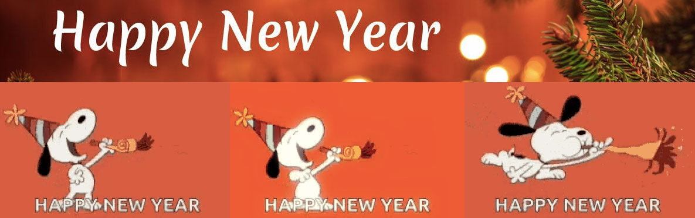
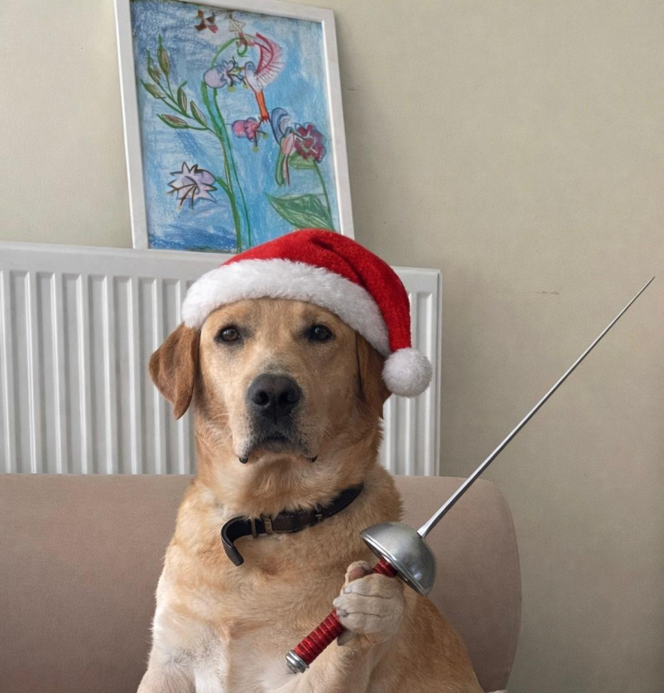

## A Happy New Year 2026!
<!--
**elizabethshen/elizabethshen** is a ✨ _special_ ✨ repository because its `README.md` (this file) appears on your GitHub profile.

Here are some ideas to get you started:

- 🔭 I’m currently working on ...
- 🌱 I’m currently learning ...
- 👯 I’m looking to collaborate on ...
- 🤔 I’m looking for help with ...
- 💬 Ask me about ...
- 📫 How to reach me: ...
- 😄 Pronouns: ...
- ⚡ Fun fact: ...
-->

 

Master of Computer Science. Received ***IBM Professional Data Science Certificate*** in 2020. 

https://www.linkedin.com/pulse/brussels-best-neighborhoods-expats-elizabeth-shen/?trackingId=n54YI5mVRt6eB1wniArQ6A%3D%3D  

Experienced Website project manager/Internet business consulting 
Strong Communication Skills: Know how to talk to clients in a way that they understand, with or without IT backgrounds. 

Passionate about Data Science/Machine Learning, extremely curious to learn and explore more. 
I am especially interested in the **Data Modelling and Prediction**.  
 
I am looking for a Data Scientist job, to learn and work more in this area.   Combining my experiences with business, strong interest in numbers and Patterns and world traveling experiences and an understanding of different cultures, I believe I can make an unique contribution and a long term, an outstanding player. 
 

I am going to create a project called **Uppie Baby Tutorial**, to make data science an easy learning process for every one.   
This is Uppie, a real lab ( with an AI Epee)!    
  
Please feel free to reach me: elizabeshen@gmail.com  
 
Best wishes! 

